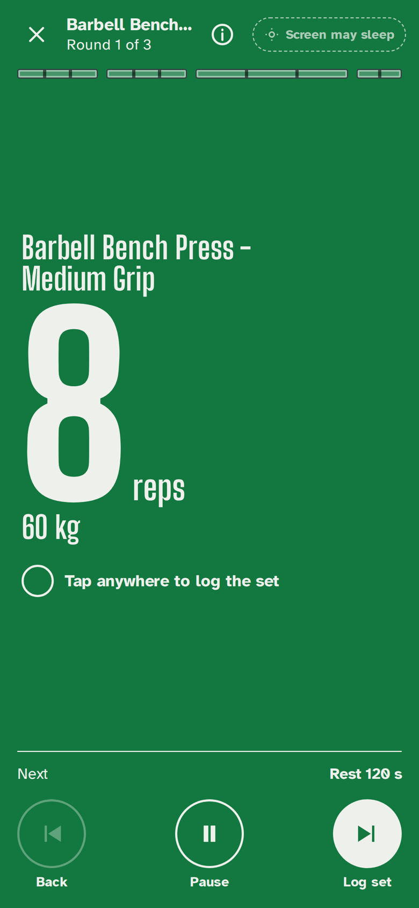
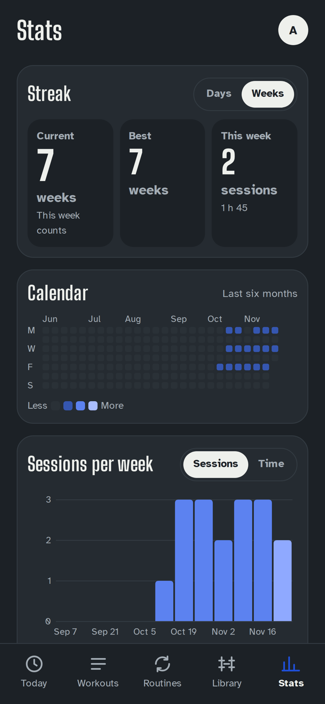

# Setryx

A self-hosted workout tracker for one household or a group of friends. It runs as a single Docker container serving plain HTTP. If you want HTTPS, put your own reverse proxy in front.

What it does:

- **Workouts:** build them from a library of 876 exercises plus your own, with sets, reps, weights, timed holds, rests and supersets.
- **Player:** a full-screen guide through the workout, with timers, sounds and voice cues. It keeps the screen on and picks up where you left off after a reload.
- **Review:** check what you did after each workout. Setryx suggests new targets and updates the workout if you agree.
- **Offline:** finish a workout with no connection; it uploads when the server is reachable again.
- **Routines:** a rotation (Push A, Pull A, …), a one-off programme, or a weekly plan. Today shows what's up next.
- **Stats:** a streak, a calendar, sessions per week, and charts and records for each exercise.
- **Accounts:** everyone has their own data; an admin adds people or sends invite links.
- **API and MCP:** personal tokens let scripts and AI agents read and edit your workouts (see [API](#api) and [AI agents](#ai-agents-mcp)).

<p align="center">
  
  
  
</p>

## Run it

Save this as `docker-compose.yml` and start it with Docker Compose:

```yaml
services:
  setryx:
    image: ghcr.io/underpath/setryx:latest
    container_name: setryx
    restart: unless-stopped
    ports:
      - "38471:38471"
    environment:
      # Set to true when a reverse proxy sits in front, so HTTPS and client IPs are detected.
      TRUST_PROXY: "false"
      # Public address, used in invite links. When set, the server only answers to this host
      # (and ALLOWED_HOSTS), which blocks DNS-rebinding pages.
      # BASE_URL: https://setryx.example.com
      # Other names or addresses you open Setryx by, comma separated.
      # ALLOWED_HOSTS: 192.168.1.5,setryx.lan
      # The user and group Setryx runs as, and who owns its files (default 1000).
      # PUID: "1000"
      # PGID: "1000"
    volumes:
      - setryx-data:/data
      - setryx-images:/images

volumes:
  setryx-data:
  setryx-images:
```

Open `http://<your-server>:38471`. The first account you create becomes the admin. Sign-up then closes. To add people, go to **Settings → People and invites**, then either create accounts yourself or send invite links.

Two volumes hold everything:

- `setryx-data` (`/data`): the SQLite database, the generated session secret and database copies (`backups/`).
- `setryx-images` (`/images`): exercise photos, if you turn them on. They're kept apart so backups of your data don't carry them.

### Exercise photos (optional)

The exercise library and its photos come from [free-exercise-db](https://github.com/yuhonas/free-exercise-db) (public domain). Photos are off by default, and Setryx contacts nothing outside your network until an admin turns them on under **Settings → Exercise photos**. Once on, each photo is downloaded from that repository the first time someone opens that exercise. Downloads that redirect, pass 3 MB or aren't JPEGs are refused. Or use **Download all** to fetch every photo up front (about 100 MB). They're kept in the `/images` volume, and **Remove downloaded photos** deletes them again. Your own exercises have no photos.

### Configuration

| Variable | Default | What it does |
|---|---|---|
| `PORT` | `38471` | Port the server listens on |
| `TRUST_PROXY` | `false` | Set `true` behind a reverse proxy, so HTTPS and client IPs are detected |
| `COOKIE_SECURE` | `auto` | `auto` marks cookies Secure when the proxy reports HTTPS or `BASE_URL` is `https://`; or `true` / `false` |
| `BASE_URL` | (unset) | Public address, e.g. `https://setryx.example.com`. Used in invite links, and the server only answers to its host (plus `ALLOWED_HOSTS`) |
| `ALLOWED_HOSTS` | (unset) | More names or addresses the server answers to, comma separated, e.g. `192.168.1.5,setryx.lan`. A name without a port matches any port |
| `SESSION_SECRET` | generated | Signs session cookies; at least 32 characters. Left unset, Setryx generates one and keeps it in `/data` |
| `IMAGES_DIR` | `/images` | Where downloaded exercise photos are kept |
| `PUID` / `PGID` | `1000` | The user and group id Setryx runs as (see below) |

**File ownership (`PUID` and `PGID`).** Setryx runs as user and group 1000, not as root. On start, the container gives `/data` and `/images` to that user, so a host folder or an old volume owned by someone else works without changes. Then it drops root before Setryx starts. If your host folders should belong to a different user, for example to match your NAS account, set `PUID` and `PGID` to that user's ids (run `id` on the host to see them). Files already there are handed over on the next start. If you start the container with compose's `user:` instead, that user is used as is and nothing is changed, so its folders must already be writable by it.

Set `BASE_URL` or `ALLOWED_HOSTS`. Then Setryx turns away requests for any other host name, which stops a malicious web page from reaching a server on your network through its own name (DNS rebinding). Without either, the server logs a warning at startup. If you open Setryx by more than one address, for example a public name and a LAN address, list them all.

### HTTPS (optional)

Setryx works over plain HTTP, including finishing a workout with no connection: sessions are kept on the device and upload when the server is reachable again. With HTTPS, devices can also install Setryx as an app, open it with no connection at all, and use the browser's own keep-screen-on feature. Put any reverse proxy in front of port 38471.

Set `TRUST_PROXY: "true"` and `BASE_URL` when using a proxy. With an `https://` `BASE_URL`, the session cookie is marked Secure and named `__Host-setryx_session`.

Plain HTTP is fine on a network you trust. Don't expose it to the internet: passwords, the session cookie and API tokens would travel unencrypted.

### Backups

Your data lives in the `/data` volume, so backing up that volume backs up Setryx. A few things make that safe:

- The database file, `setryx.db`, always holds every saved change on its own; there's no side file to copy along.
- Setryx also keeps complete copies in `/data/backups` that are always written in one go, so a backup tool can never catch one half-written:
  - `setryx-latest.db`, refreshed once a day when something changed, and when the container stops;
  - `setryx-before-v<N>-<time>.db`, taken just before an update changes the database (the last 3 are kept).
- An admin can change the folder, how many copies are kept and how often the up-to-date copy refreshes under **Settings → Backups**, and make a copy by hand. To keep copies outside the data volume, mount another volume and point the folder at it.

Exercise photos are in their own `/images` volume, not in `/data` or the copies; they can always be downloaded again.

To restore a copy:

```bash
docker compose stop setryx
docker compose run --rm --no-deps --entrypoint sh setryx -c 'cp /data/backups/setryx-latest.db /data/setryx.db && rm -f /data/setryx.db-wal /data/setryx.db-shm /data/setryx.db-journal'
docker compose start setryx
```

Replace `setryx-latest.db` with whichever copy you want. Run these from the folder with your `docker-compose.yml`.

### API

Scripts and AI agents can use your data through the API. Create a token under **Settings → API and AI agents**, then send it with every request:

```bash
curl -H "Authorization: Bearer setryx_…" http://<your-server>:38471/api/v1/workouts
```

- **Read only** tokens can look at your exercises, workouts, routines, sessions and stats. **Read and write** tokens can also create, change and delete them.
- A token only ever sees its owner's data. It can't sign in, change account or server settings (people, photos, backups), import or export, or manage tokens.
- Creating a token asks for your password.
- Tokens can expire after 30 days, 90 days or a year, or never. Revoke one at any time.
- Changing your password revokes your tokens too, unless you untick **Also revoke my API tokens**. Turning an account off deletes its tokens for good, and an admin password reset (or `reset-password`) revokes them.
- Every endpoint a token can use is described in OpenAPI at `/api/v1/openapi.json`.

### Limits

An admin sets these under **Settings → Limits**. They take effect straight away, for existing sign-ins too. Using the app isn't rate limited.

| Limit | Default | Applies to |
|---|---|---|
| Wrong passwords a minute for each account | 10 | counted per account rather than per address, so a proxy doesn't affect it. Each device that has signed in to the account before gets its own count. Changing a password or creating a token counts per signed-in session |
| Days a sign-in lasts without use | 30 | after that, that device is signed out |
| Days a sign-in lasts at most | 90 | everyone signs in again this long after signing in; can be turned off |
| Devices each person can be signed in on | 5 | signing in on one more signs out the device used longest ago |
| Requests a minute for each token | 120 | the API and MCP together; can be turned off |
| Tokens each person can have | 5 | lowering it keeps existing tokens |
| Storage for each person | 100 MB | workouts, routines, own exercises and sessions; can be turned off |

A short burst up to a limit is fine. Going over a rate limit gets HTTP 429 with a `Retry-After` header, and API responses carry `RateLimit-Limit` and `RateLimit-Remaining`. Once an account reaches its wrong-password limit, signing in to it waits a few seconds between tries, even with the right password. A username that doesn't exist never gets a real password check: the answer just takes about as long as one would, so a flood of made-up names can't slow sign-ins down or show which names exist. A few places in the password-check queue are also kept for devices that have signed in before and for people already signed in.

**Known devices.** Someone guessing an account's password could otherwise keep its owner locked out. To prevent that, a browser that signs in with the password keeps a device cookie (`setryx_device`, signed, HttpOnly, for a year, and kept when you sign out). Sign-ins from a known device are counted on their own, so guessing from elsewhere doesn't lock it out. A device that has never signed in to that account waits until the guessing stops. Changing your password, **Sign out everywhere else**, an admin password reset, `reset-password` and turning the account off all forget the account's other devices. While an account's shared count is used up, the server logs a warning and admins see a notice on Today and under **People and invites**.

A full storage allowance answers 507; deleting still works, and a session logged offline stays on the device until there's room. Counts are kept in memory, so a restart resets them (`docker restart setryx` clears a lockout, though guessing that carries on fills the count again).

Everyone can see where they're signed in under **Settings → Account** and sign out any device.

**Shared devices.** Signing out deletes what your account keeps on that device: an unfinished workout, finished ones waiting to be saved, anything not yet synced, and the offline copy of your workouts. If some of it hasn't reached the server, Setryx tries to send it first and asks before deleting what's left. When a session ends without signing out (it expired, you signed it out from another device, or the account was turned off), the offline copy goes, but unsynced workouts stay so they sync when you sign in again. Nobody else signing in on that device sees them.

### AI agents (MCP)

Agents like Claude can connect to Setryx over MCP at `http://<your-server>:38471/mcp`, signing in with an API token. For example, in Claude Code:

```bash
claude mcp add --transport http setryx http://<your-server>:38471/mcp --header "Authorization: Bearer setryx_…"
```

The agent gets tools to check what's next and your training summary; search exercises and read your history; create and edit workouts, targets and routines; and log a session done without the app. Exercises, workouts and routines can be named instead of given by id. A read-only token only gets the reading tools. Tools that delete or overwrite (updating an exercise or a workout, editing a routine) are marked so clients ask first, and sessions can't be deleted over MCP. MCP is off by default: an admin turns it on under **Settings → API and AI agents**. The API works with tokens either way.

### Locked out?

```bash
docker exec -it setryx list-users
```

```bash
docker exec -it setryx reset-password <username>
```

The new password isn't shown as you type it, and you type it twice. It needs `-it` so there's a terminal to type into. This also turns the account back on, signs it out everywhere and revokes its API tokens.

## Develop

Needs Node 24.7 or newer. TypeScript runs directly in Node, with no build step for the server.

```bash
npm install
```

```bash
npm run dev
```

The API runs on :38471 and Vite on :5173 (it proxies `/api`). Other commands: `npm test` runs the shared logic and API tests, `npm run typecheck` checks types, and `npm run build` builds the web app into `apps/web/dist`, which the server serves.

Every push to `main` runs the tests and publishes `ghcr.io/underpath/setryx:latest` (see `.github/workflows/docker.yml`). A tag like `v1.0.0` also publishes `1.0.0`, `1.0` and `1`, and pull requests are tested and built without publishing.

Layout: `apps/server` (Fastify + built-in `node:sqlite`), `apps/web` (React + Vite, installable as an app), `packages/shared` (schemas and the logic used by both: the workout player, routines and stats), `e2e` (the browser test).

### End-to-end test

A full workout (first-run setup, playing a workout, the review, saving, Stats) runs in a real browser, entirely in containers: a throwaway Setryx built from the current code with an empty database, and Microsoft's Playwright image with Chromium. Nothing is installed on your machine.

```bash
sh e2e/run.sh
```

It starts from an empty database every time and removes the test copy of Setryx when it's done. The Playwright image is a large one-off download (Docker lists it at about 3.5 GB); remove it with `docker rmi mcr.microsoft.com/playwright:v1.55.0-noble` when you no longer need it.

## License

Setryx is under the [MIT License](LICENSE). The exercise library comes from [free-exercise-db](https://github.com/yuhonas/free-exercise-db), which is public domain. The fonts are under the SIL Open Font License, and the other packages Setryx ships are listed with their licenses in [THIRD_PARTY_LICENSES.md](THIRD_PARTY_LICENSES.md). After changing dependencies, regenerate that file with `node scripts/third-party-licenses.mjs`.
